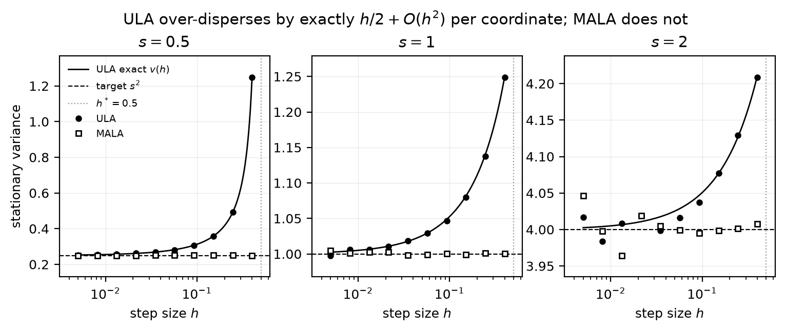
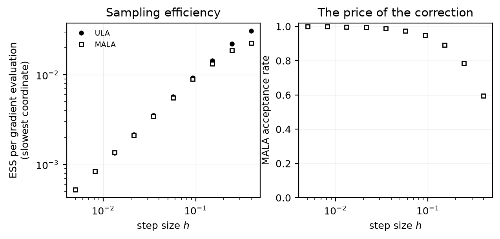
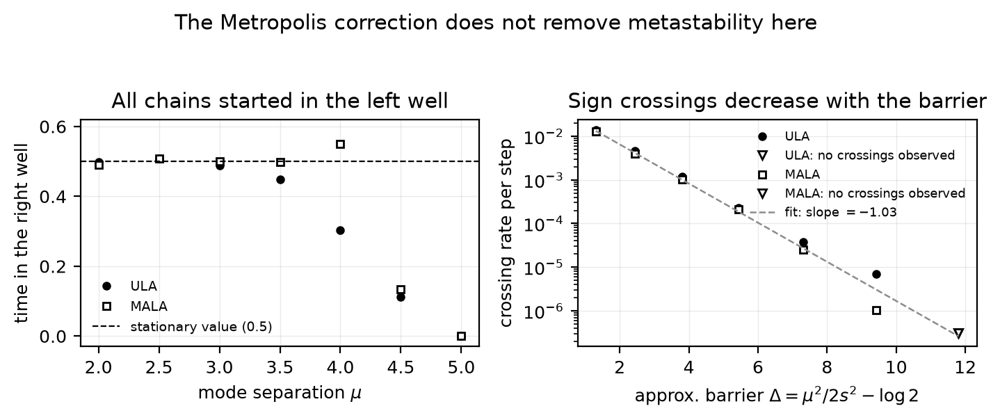

# Langevin samplers: discretization bias against exact references

A numerical study of what you give up by dropping the Metropolis correction from a
Langevin sampler. Gaussian discretization bias is checked against an exact stationary
law; a separated-mixture experiment then shows the distinct problem of slow mixing.

The math in one paragraph. The overdamped Langevin diffusion
`dX_t = ∇log π(X_t) dt + √2 dW_t` leaves `π` invariant, so discretizing it gives a
sampler. The Euler-Maruyama discretization, the *unadjusted* Langevin algorithm
`X_{k+1} = X_k + h ∇log π(X_k) + √(2h) ξ_k`, has an invariant law `π_h` that generally
differs from `π` when the discretized chain is stable and ergodic. That gap is the
discretization bias. Metropolizing the same move (MALA)
restores exact reversibility with respect to `π` at the cost of an accept/reject step. On
a Gaussian target `N(0, diag(s²))` the ULA chain is a coordinatewise AR(1),
`X' = (1 − h/s²)X + √(2h) ξ`, which is stationary iff `0 < h < 2s²` and whose stationary
variance solves `v = (1 − h/s²)²v + 2h`:

```
v(h) = s² / (1 − h/(2s²)),      v(h) − s² = (h/2)/(1 − h/(2s²)) = h/2 + O(h²).
```

So ULA over-disperses at every step size, the leading-order variance inflation is `h/2`
*independently of the scale* `s`, and the induced Wasserstein error is first order,
`W₂(π_h, π) = (h/4)·(Σ_i s_i⁻²)^{1/2} + O(h²)`. Since `π_h` is known exactly, the
simulations here can be validated against a formula rather than against a longer run of
themselves: the measured ULA variance has to agree with `v(h)` to within Monte Carlo
error, and a failure convicts the sampler rather than the theory.

The step-size ceiling comes from the *narrowest* direction (`h < 2 min_i s_i²`) while the
time to decorrelate comes from the widest, which is why ill-conditioned targets are hard
for Langevin methods. Here that shows up directly in the AR(1) coefficients.

## What the experiments show

1. Gaussian bias (`scripts/01`). ULA and MALA over a decade and a half of step sizes on
   an anisotropic Gaussian (`s = 0.5, 1, 2`; 4:1 scale ratio, 16:1 covariance condition
   number, stability limit
   `h* = 0.5`). Recovers the exact `v(h)` curve, the first-order `W₂` rate, and the
   acceptance-rate collapse that is the price of the correction.
2. Metastability (`scripts/02`). A separated two-component mixture, sweeping the
   large-separation *barrier approximation* `Δ(μ) = μ²/2s² − log 2` at fixed step size,
   with every chain started in the left well. Kramers-type asymptotics suggest a leading
   exponential `exp(−Δ)`, with a separation-dependent prefactor. The experiment counts
   discrete sign crossings, including recrossings, after burn-in; its fitted slope is
   a numerical comparison rather than an exact transition-rate identity. At `μ = 5`
   neither sampler crosses during the measured window. MALA is unbiased *in stationarity*,
   but a chain trapped near its initial well is nowhere near stationarity. Correcting
   discretization bias does not by itself ensure rapid mixing.

## Results

The Gaussian experiment compares 10 step sizes and 3 coordinates with
`v(h) = s²/(1 − h/2s²)`. Variance standard errors use independent-chain averages of
the squared centered observable, preserving its temporal correlation. They measure
Monte Carlo sampling error, not shared initialization bias or convergence to stationarity.
In the saved full run, all 30 coordinate-step-size cases lie within three estimated
variance standard errors; the relative standard errors range from 0.11% to 0.85%.
At `h = 0.4`, four fifths of the way to the stability limit, the measured variances are
`[1.2479, 1.2488, 4.2085]` against exact `[1.25, 1.25, 4.2105]`. MALA at the same step
size returns `[0.2494, 1.0003, 4.0075]` against the target `[0.25, 1, 4]`, and its
acceptance rate falls from 0.999 to 0.595 over the same sweep. ULA's error is a bias you
cannot average away; MALA's is a cost paid in rejected proposals.



ESS in the efficiency plot refers to coordinate means. Gradient cost counts actual
individual-chain score evaluations: ULA uses one per step, while MALA caches the current
score and uses one per proposal plus one initial evaluation per chain. This does not
count log-density evaluations or other overhead, so it is not a wall-clock comparison.
The plotted Wasserstein estimates are zero-mean diagonal-Gaussian covariance proxies;
they omit empirical mean and off-diagonal covariance errors.



Both algorithms exhibit metastability in the mixture experiment. Fitting
`log(crossing rate)` against `Δ = μ²/2s² − log 2` gives slope -0.948 for ULA
(R² = 0.998) and -1.032 for MALA (R² = 0.999), near the leading exponential's slope -1.
By `μ = 5` (`Δ = 11.8`) ULA records zero crossings with all 32 chains still in the well
they started in, and MALA, unbiased in stationarity, is stuck in exactly the same way.



## Layout

```
src/langevin/     library
  targets.py      Gaussian and two-component mixture (score + reference moments)
  samplers.py     ULA and MALA, vectorized over independent chains
  theory.py       exact ULA stationary law, stability limit, Gaussian W2
  diagnostics.py  Geyer ESS for means, pooled moments, independent-chain variance SE
  provenance.py   run sidecars (parameters, seed, resolved commit SHA)
scripts/          01 gaussian bias -> 02 multimodal -> 03 figures
results/          JSON outputs + .meta.json sidecars
figures/          PDFs and PNGs
tests/            analytic sampler, accounting, uncertainty-calibration and provenance checks
```

## Reproduce

```bash
uv sync
uv run python -m unittest discover -s tests -v
uv run python scripts/01_gaussian_bias.py --smoke   # ~10s pipeline check
uv run python scripts/01_gaussian_bias.py
uv run python scripts/02_multimodal.py
uv run python scripts/03_plot.py
```

Every run is seeded (`np.random.default_rng`, streams keyed by role and configuration so
each point reproduces independently of iteration order) and writes a sidecar with its
full parameter set, seed, and resolved git commit. Stage 03 reads only saved results, so
figures regenerate without re-sampling. Pure NumPy, no autodiff framework.
Sidecars identify the source revision; generated `results/` and `figures/` changes do
not mark source code dirty. The validation sidecar also hashes its input result file.
GitHub Actions runs the regression suite and a small end-to-end pipeline on every push
and pull request. The AR(1) uncertainty test compares predicted variance standard
errors with the actual spread across independent simulated experiments.

## References

- Roberts, G. O. and Tweedie, R. L. (1996). Exponential convergence of Langevin
  distributions and their discrete approximations. *Bernoulli* 2(4), 341-363.
- Roberts, G. O. and Rosenthal, J. S. (1998). Optimal scaling of discrete approximations
  to Langevin diffusions. *JRSS-B* 60(1), 255-268.
- Dalalyan, A. S. (2017). Theoretical guarantees for approximate sampling from smooth and
  log-concave densities. *JRSS-B* 79(3), 651-676.
- Durmus, A. and Moulines, É. (2017). Nonasymptotic convergence analysis for the
  unadjusted Langevin algorithm. *Annals of Applied Probability* 27(3), 1551-1587.

## License

MIT. Discussed at [akshatvalse.com/research](https://akshatvalse.com/research), where the
Lifson-Jackson diffusivity check runs live.
